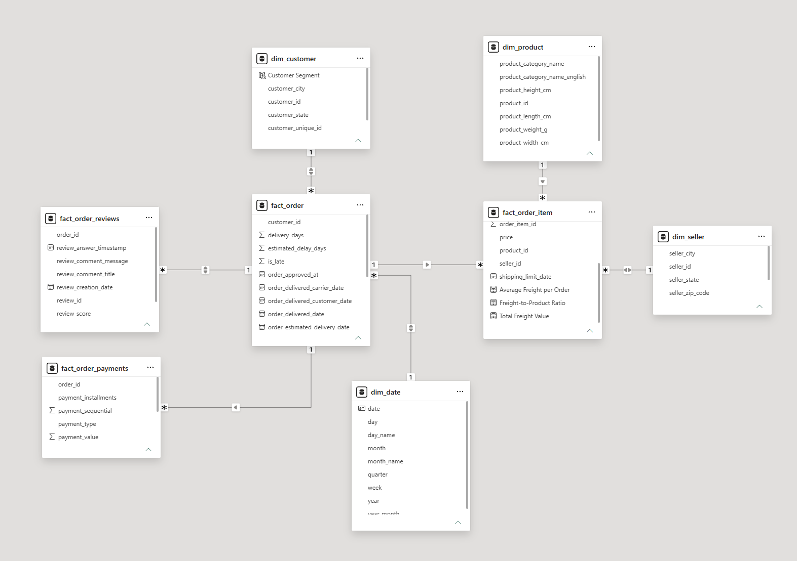
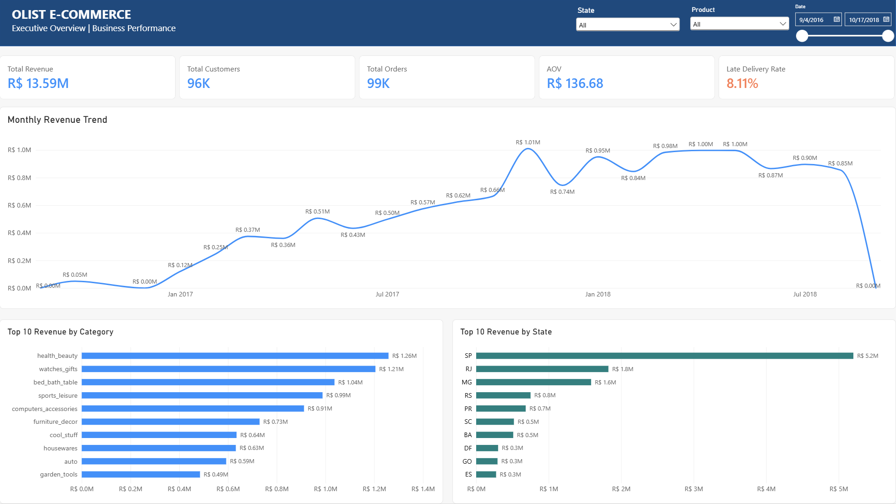
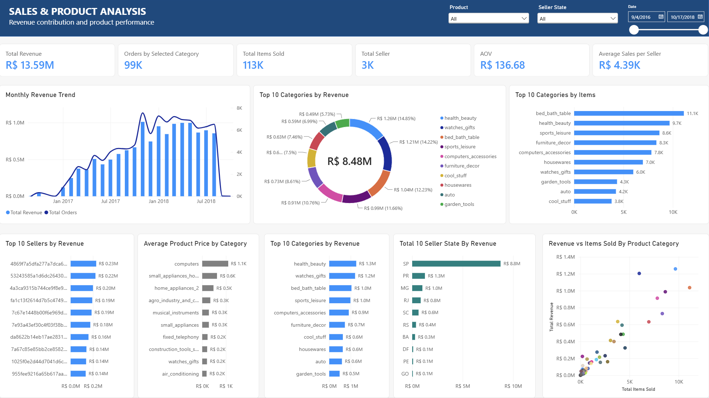
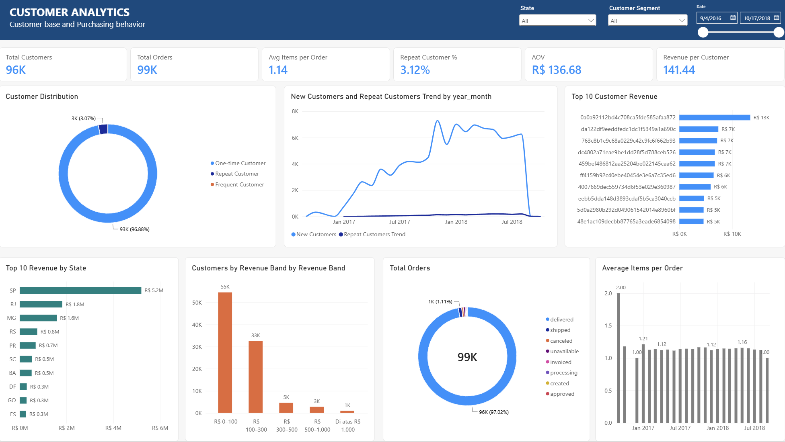
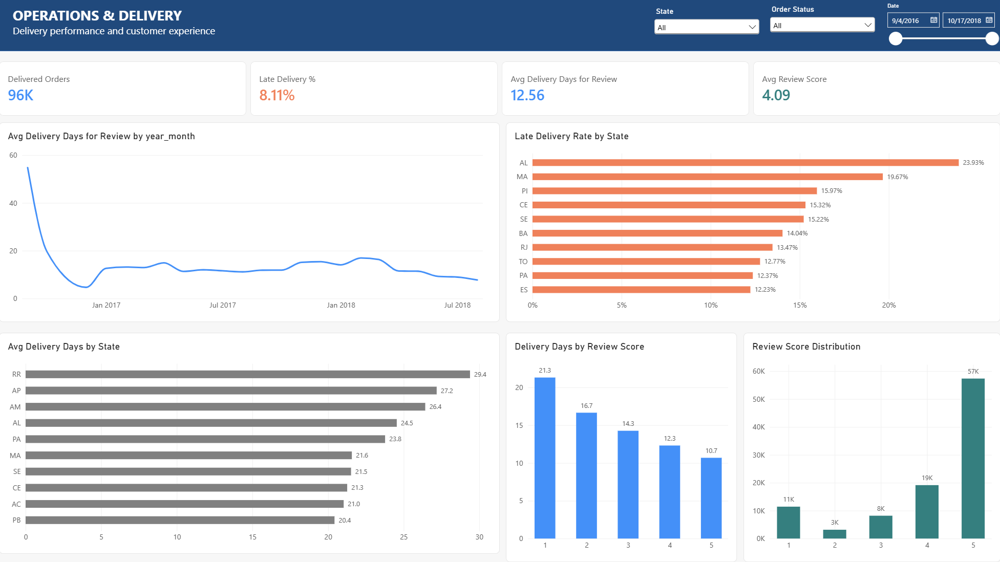
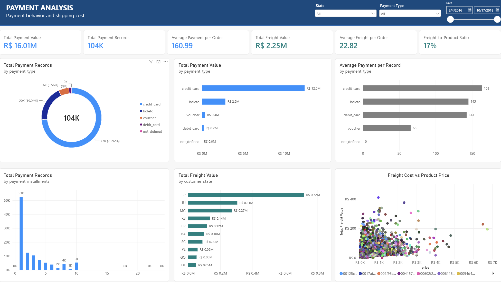

# 📊 Olist E-Commerce Business Intelligence Analysis

# 📌 Project Overview

This project analyzes the business performance of Olist, one of Brazil's largest e-commerce marketplaces.

The objective is to transform raw transactional data into actionable business insights through:

- Data Cleaning & Preparation
- Exploratory Data Analysis (EDA)
- Data Modeling (Star Schema)
- SQL Analytics
- Power BI Dashboard Development
- Business Insight Generation
- Strategic Business Recommendations

The project focuses on understanding:

- Revenue Growth
- Product Performance
- Customer Behavior
- Seller Performance
- Logistics and Delivery Efficiency
- Payment Preferences
- Profitability Drivers

---

# 🎯 Business Problem

Like many growing e-commerce companies, Olist faces challenges in:

- Scaling revenue sustainably
- Retaining customers
- Managing delivery performance
- Optimizing logistics costs
- Diversifying revenue sources
- Understanding customer purchasing behavior

This analysis aims to answer critical business questions such as:

1. What drives revenue growth?
2. Which products generate the highest business value?
3. Why are repeat purchases low?
4. How does logistics performance affect customer satisfaction?
5. What operational improvements can increase profitability?

---

# 📂 Dataset

Dataset Source:

**Olist Brazilian E-Commerce Dataset**

The dataset contains:

- Customers
- Orders
- Products
- Sellers
- Payments
- Reviews
- Geolocation
- Order Items

### Dataset Size

| Table | Records |
|---------|---------:|
| Customers | 99K+ |
| Orders | 99K+ |
| Sellers | 3K+ |
| Products | 32K+ |
| Payments | 100K+ |
| Reviews | 100K+ |

---

# 🏗 Data Architecture

The project follows a Star Schema design.

## Fact Tables

- Fact Orders
- Fact Payments
- Fact Reviews
- Fact Order Item

## Dimension Tables

- Dim Customers
- Dim Sellers
- Dim Products
- Dim Date

### Star Schema

```text

                      
                      
                
```

---

# 🛠 Tools & Technologies

| Tool | Purpose |
|---------|---------|
| Python | Data Cleaning & EDA |
| Pandas | Data Transformation |
| PostgreSQL | Data Warehouse |
| SQL | Business Queries |
| Power BI | Dashboard Development |
| DAX | KPI Calculations |
| GitHub | Portfolio Documentation |

---

# 📈 Dashboard Overview

The Power BI solution consists of five business-focused dashboards.

---

## 1️⃣ Executive Overview

### Dashboard Preview



### Purpose

Provide an executive-level business summary.

### KPIs

- Total Revenue
- Total Orders
- Total Customers
- Average Order Value
- Late Delivery Rate

### Key Findings

- Revenue reached R$13.59M.
- Revenue growth accelerated significantly during 2017–2018.
- Revenue is concentrated in São Paulo and a few key categories.

---

## 2️⃣ Sales & Product Analysis

### Dashboard Preview



### Focus Area

Product and sales performance.

### Key Findings

- Health & Beauty generated the highest revenue.
- Top 10 categories contributed 62% of total revenue.
- Computers and Electronics products have the highest average prices.
- Revenue is highly concentrated among a small group of sellers.

---

## 3️⃣ Customer Analytics

### Dashboard Preview



### Focus Area

Customer acquisition and retention.

### Key Findings

- 96K Customers generated 99K Orders.
- Repeat Customer Rate is only 3.12%.
- 96.88% of customers purchased only once.
- Customer Lifetime Value remains low.

### Business Impact

Customer retention is the largest growth opportunity.

---

## 4️⃣ Operations & Delivery

### Dashboard Preview



### Focus Area

Logistics performance and customer experience.

### Key Findings

- Delivery Success Rate: 97%.
- Late Delivery Rate: 8.11%.
- Faster delivery directly improves customer ratings.

### Critical Insight

Customers who gave:

- ⭐⭐⭐⭐⭐ ratings received products in 10.7 days.
- ⭐ ratings received products in 21.3 days.

Delivery performance has a direct impact on customer satisfaction.

---

## 5️⃣ Payment Analysis

### Dashboard Preview



### Focus Area

Payment behavior and logistics costs.

### Key Findings

- Credit Card contributes 78% of payment value.
- Freight Cost reached R$2.25M.
- Logistics cost represents 17% of product value.

### Business Impact

Freight optimization presents significant profitability opportunities.

---

# 🔍 Business Insights

The analysis revealed several critical business insights:

## Revenue Growth

✅ Strong revenue growth driven by customer acquisition.

---

## Customer Retention

⚠ Repeat purchase rate remains extremely low.

Only:

3.12%

of customers make additional purchases.

---

## Revenue Concentration Risk

⚠ Revenue heavily concentrated on:

- São Paulo
- Top Product Categories
- Top Sellers

---

## Logistics Performance

⚠ Delivery delay has a measurable impact on customer satisfaction.

---

## Profitability Opportunity

⚠ Freight cost accounts for 17% of product value and represents a major optimization opportunity.

---

# 📋 Strategic Recommendations

## Customer Retention

- Loyalty Program
- Membership Program
- Personalized Promotions

---

## Increase Average Order Value

- Cross-Selling
- Product Bundling
- Free Shipping Threshold

---

## Logistics Optimization

- Improve Delivery SLA
- Regional Fulfillment Centers
- Logistics Partner Evaluation

---

## Revenue Diversification

- Expand beyond São Paulo
- Increase regional seller acquisition

---

## Freight Optimization

- Route Optimization
- Warehouse Optimization
- Shipping Consolidation

---

# 📊 Project Deliverables

```text
├── README.md
├── dashboard
│   ├── screenshots
│          ├── Executive Overview.png
│          ├── Sales & Product Analysis.png
│          ├── Customer Analytics.png
│          ├── Operations & Delivery.png
│          └── Payment Analysis.png
│   ├── olist_bii.pbix
|
├── data
│   ├── analytics
│          ├── category_sales.csv
│          ├── customer_metrics.csv
│          ├── customer_rfm.csv
│          ├── customer_segments.csv
│          ├── delivery_review_analysis.csv
│          ├── monthly_sales.csv
│          └── state_analysis.csv
|
│   ├── processed
│          ├── dim_customer.csv
│          ├── dim_date.csv
│          ├── dim_product.csv
│          ├── dim_seller.csv
│          ├── fact_delivery.csv
│          ├── fact_order.csv
│          ├── fact_order_item.csv
│          ├── fact_sales.csv
│          └── monthly_sales.csv
|
|   ├── raw
│          ├── olist_customers_dataset.csv
│          ├── olist_geolocation_dataset.csv
│          ├── olist_order_items_dataset.csv
│          ├── olist_order_payments_dataset.csv
│          ├── olist_order_reviews_dataset.csv
│          ├── olist_orders_dataset.csv
│          ├── olist_products_dataset.csv
│          ├── olist_sellers_dataset.csv
│          └── product_category_name_translation.csv
|
├── docs
│   ├── executive_summary.md
│   ├── business_insight.md
│   └── business_recommendations.md
│
│
├── notebooks
│   ├── 01_data_understanding.ipynb
│   ├── 02_data_quality.ipynb
│   ├── 03_eda_business_analysis.ipynb
│
├── sql
│   ├── 01_create_tables.sql
│   ├── 02_data_quality_checks.sql
│   ├── 03_sales_product_analysis.sql
|   ├── 04_customer_analysis.sql
|   ├── 05_operations_delivery.sql
|   └── 06_payment_review_analysis.sql
```

---

# 💡 Key Portfolio Takeaway

This project demonstrates the complete end-to-end workflow of a Business Intelligence Analyst, covering data preparation, dimensional modeling, SQL analysis, dashboard development, business insight generation, and strategic recommendations.

The analysis identified that Olist's greatest growth opportunity is not acquiring more customers, but improving customer retention, logistics efficiency, and operational profitability.

---

# 👤 Author

**Nur**

Business Intelligence Analyst Portfolio Project

Tools:
Power BI | SQL | PostgreSQL | Python | Business Analytics
